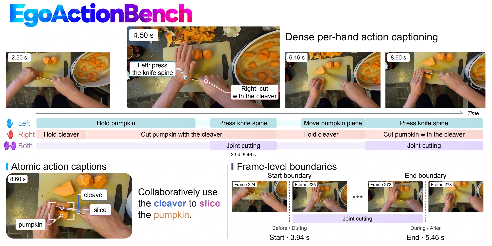

<div align="center">

# EgoActionBench: Benchmarking Dense Action Captioning for Egocentric Human Videos

**Official repository for the paper**

<a href="https://egoaction-bench.github.io"></a>
<!-- TODO: replace XXXX.XXXXX with the arXiv ID once the paper is announced -->
<a href="https://arxiv.org/abs/XXXX.XXXXX"></a>
<a href="assets/egoaction-film.mp4"></a>


</div>

<p align="center">
  
</p>

## News

- **2026/10**: Paper and arXiv page released.
- **2026/10**: Project page and demo video are online.
- **Coming soon**: Benchmark annotations, evaluation toolkit, model checkpoints, and training code will be released after cleanup.

## Introduction

**EgoActionBench** is a benchmark for dense action captioning in egocentric
human videos. It represents continuous human manipulation as temporally
localized atomic actions, each associated with the left hand, right hand, or
both hands. Given a clip, a model must recover *what* the camera wearer does,
*when* each action happens, and *which hand* performs it.

EgoActionBench contains **1,407 episodes** with **41,132 human-refined action
annotations**, curated from Ego4D, EgoLife, and EPIC-KITCHENS-100. We benchmark
19 vision-language models and introduce **EgoAction**, adapted from Qwen3-VL-4B
and LLaVA-OneVision-2-8B through supervised fine-tuning followed by
reinforcement learning.

## Evaluation Protocol

EgoActionBench uses a progressive evaluation protocol for dense predictions:

- **Candidate retrieval**: temporally eligible predictions are retrieved for each reference action.
- **Prediction selection**: one candidate is selected per reference action by content agreement.
- **Scoring**: semantic fidelity and temporal overlap are scored alongside action precision and recall, summarized as **EgoActionScore**.

## Highlights

- Atomic, temporally localized action annotations on Left, Right, and Both hand tracks.
- A protocol that jointly evaluates what happens, when it happens, and which hand performs it.
- A benchmark of 19 proprietary and open-source vision-language models.
- EgoAction improves EgoActionScore by 15.9 and 23.2 points on its two backbones and outperforms all open-source baselines.

## TODO List

This `main` branch is currently a lightweight landing branch. The benchmark
data and code have not been released yet.

- [x] Release paper and arXiv.
- [x] Publish the project page.
- [x] Add the demo MP4.
- [ ] Release EgoActionBench annotations and episode index.
- [ ] Open-source the evaluation toolkit (EgoActionScore).
- [ ] Release baseline predictions for the 19 evaluated VLMs.
- [ ] Release EgoAction checkpoints.
- [ ] Release automatically annotated training data and training scripts (SFT and RL).
- [ ] Add license and detailed environment instructions.

## Quick Start

The evaluation toolkit is still under preparation. After the public release,
this section will include environment setup, data download, and evaluation
commands.

```bash
git clone https://github.com/player0718/EgoActionBench.git
cd EgoActionBench

# TODO: install environment
# TODO: download annotations and source videos
# TODO: run evaluation
```

For now, please see the [project page](https://egoaction-bench.github.io) for
annotation examples and benchmark results.

## Data Sources

EgoActionBench builds on videos from [Ego4D](https://ego4d-data.org),
[EgoLife](https://egolife-ai.github.io), and
[EPIC-KITCHENS-100](https://epic-kitchens.github.io). Access to the source
videos is governed by their original licenses and terms of use.

## Citation

If you find EgoActionBench helpful, please consider citing:

```bibtex
@article{shen2026egoactionbench,
  title   = {EgoActionBench: Benchmarking Dense Action Captioning for Egocentric Human Videos},
  author  = {Shen, Yujiao and Song, Jiahe and Li, Haitian and Yang, Jingkang and Liu, Ziwei},
  journal = {arXiv preprint arXiv:XXXX.XXXXX},
  year    = {2026}
}
```
